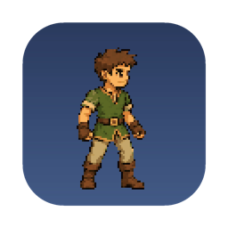

# Everything's Broken

A 2D pixel-art platformer. Run, jump, slide and wall-jump through the level,
punch and cast spells at enemies, and open chests to find loot.

## ⬇️ Download

**[Get the latest version →](https://github.com/willsllc/everythings-broken/releases/latest)**

Under **Assets**, download the file for your computer:

| Computer | File |
|---|---|
| Windows | `EverythingsBroken-<version>-Windows.zip` |
| Mac (Apple Silicon: M1 or newer) | `EverythingsBroken-<version>-Mac.dmg` |

## Install

**Windows:** unzip the file and double-click `EverythingsBroken.exe`.
If Windows shows *"Windows protected your PC"*, click **More info → Run anyway**.

**Mac:** open the `.dmg` and drag the game into **Applications**.
The first time you open it, macOS will block it, because it isn't from the
App Store. Go to **System Settings → Privacy & Security**, scroll down, and
click **Open Anyway**.

## Controls

| Action | Keyboard / mouse |
|---|---|
| Move | WASD / arrow keys |
| Jump | Space |
| Punch / attack | Left click or Enter |
| Cast spell | Right click or Right Shift |
| Switch spell | 1 / 2 |
| Crouch | Hold S / ↓ |
| Slide | Hold S / ↓ while running |
| Wall jump | Jump at a wall while holding toward it, then press Space |
| Open chest | E |

A gamepad works too.

---

*This repository only hosts the game downloads. The game's source code is
private.*
